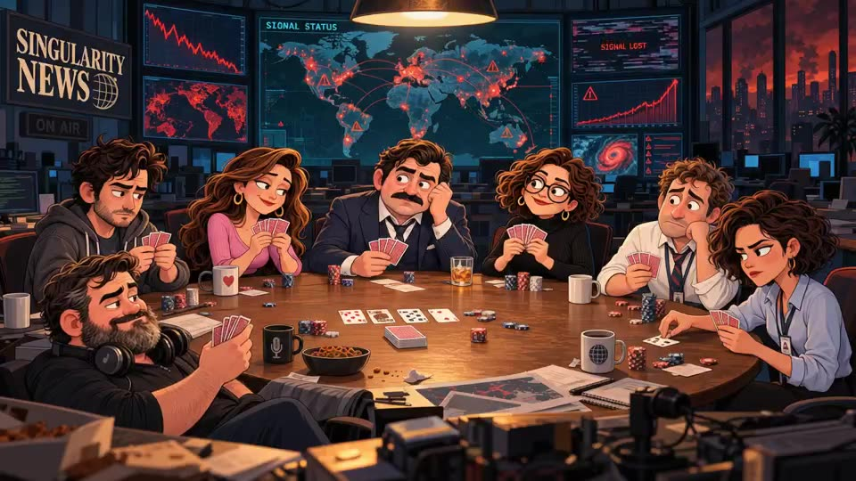

# Singularity News CCG

*Intro video: [intro.mp4](intro.mp4) · Play: [singularity-news-ccg.vercel.app](https://singularity-news-ccg.vercel.app/) · Article: [Singularity News :: CCG on DEV](https://dev.to/pengeszikra/singularity-news-ccg-5ejk)*

According these news a short action intensive card game to survive the singularity.

[0001](https://dev.to/pengeszikra/singularity-news-28p6)

[0010](https://dev.to/pengeszikra/singularity-news-0010-nhn)

[0011](https://dev.to/pengeszikra/singularity-news-0011-1ai0)

## Background – the world of Singularity News
The game is set in the world of my satirical **Singularity News** series on DEV (issues 0001, 0010, 0011 above; the game itself is presented in [Singularity News :: CCG](https://dev.to/pengeszikra/singularity-news-ccg-5ejk)), anchored by the smug news anchor Mr. Slop. The same world also appears in [Slop Coding: The Vibe Archeologist Strikes Again](https://dev.to/pengeszikra/slop-coding-the-vibe-archeologist-strikes-again-35df).

The pure-HTML, build-free approach and the Math Match rules come from my earlier card game, [flogon-galaxy](https://github.com/Pengeszikra/flogon-galaxy), which this project grew out of. Everything else – multiplayer tables, city map, singularity, groups, collection, interviews, the open-weight AI integration and the epilogue – was built during Hacktoberfest week 4 (from 26 October 2026).

## Play / PWA

`index.html` is a single-file, installable PWA (manifest + service worker + icons), landscape fullscreen.
Open it from any static host (GitHub Pages, Vercel) and use "Add to Home Screen".

- City map: 11 districts (Q Q 4 Q 4 Q 7 before the singularity, Q 4 Q 7 after it), progress saved in `localStorage`
- Quest mode (vs Big Tech CEO, AGI after the singularity), 4-player and 7-player tables
- Math Match rules from [flogon-galaxy](https://github.com/Pengeszikra/flogon-galaxy), singularity meter, news ticker, layoffs, 7 s turn timer after the singularity
- 42 rule: exactly $42M wins instantly
- Poker chip stacks show the money on the table, Auto button plays for you

## Online AI (optional)

The game runs fully without AI (built-in headlines and texts). When the page is hosted with the serverless function in `api/ai.js` (Vercel), it adds:

- **Mr. Slop headlines**: one batched call per ~6 h (cached on the server and in the browser), 3 headlines per singularity stage
- **Card interviews**: a short Q&A with any collected character (button in the card view, cached per card)
- **Final district**: starts already after the singularity, and the ending report is written by the AI

The API key stays on the server. It uses the same setup as [terminal-is-your-friend](https://dev.to/pengeszikra/terminal-is-your-friend-2b49): Groq with the open-weight `openai/gpt-oss-120b` model. Set in Vercel:

| Variable | Meaning |
| --- | --- |
| `GROQ_API_KEY` | server-side key (required) |
| `AI_BASE_URL` | optional, default `https://api.groq.com/openai/v1` |
| `AI_MODEL` | optional, default `openai/gpt-oss-120b` |
| `AI_DAILY_CAP` | optional, upstream calls per day (default 300) |
| `AI_PER_IP_HOUR` | optional, calls per IP per hour (default 24) |
| `ALLOWED_ORIGIN` | optional CORS origin (default `*`) |

If the function is missing or errors, the game silently falls back to the built-in texts.

## Ending (epilogue article)
After the last (11th) district the game ends with a full-screen, scrollable news article. Scores do not matter: you pick one collected character as the new leader, and the story is built from 42 positive / 42 negative scenario skeletons, coloured by your collected characters, their interviews, permanent unemployment and their post-singularity group (rebel / survivor / zombie). `api/ai.js` has a `story` kind (gpt-oss-120b); without AI an offline version of the skeleton is shown. Lose: Mr. Slop is a survivor carrying samizdat. Win: you run a news source of the new civilization.

## After the singularity
At the singularity every human card becomes a rebel, survivor (value +3 / −3) or zombie (value 1 worse); a few cards fly to the player and their fate is decided on screen, then they go back on top of the deck. Groups do not change the pairing rules, but pairs convert: a zombie played on a rebel turns it into a zombie, a rebel played on a survivor recruits it, a rebel played on a robot reprograms it to a random value. Permanently unemployed characters start every game unemployed.

## Bunker Market & Last Newsroom – 7 players
The 7th and the final district are 7-player elimination rounds. Everyone starts with $144M; when the turn moves on from a player, they pay as much as the burn pile grew during their turn, and the AGI burns the pile. Whoever cannot (or does not) pair with the calling card pays 7× its value (at least $7M). The deck is reshuffled when it runs out. The last player with chips wins.

## Intro
First launch: a title screen (newsroom poker illustration) with an optional intro video (`intro.mp4`, loaded only when requested), then the top card of a deck flips and introduces the game in its own voice (AI `intro` kind, with built-in texts per family as fallback). An optional pairing demo animates the four pairing rules; it can be reopened from the Rules panel, and the whole intro from the map's Intro button.

## AI models (Gemma 4 primary)
`api/ai.js` talks to two open-weight models: **Gemma 4** (`gemma-4-26b-a4b-it`) through the Gemini API, and **gpt-oss-120b** through Groq. Gemma is the default; the **AI** button on the city map switches models in the game, and if the chosen provider fails the other one answers. The article, the intro card and the news show which model wrote them.

Vercel environment variables: `GEMINI_API_KEY` (Google AI Studio), `AI_PROVIDER=gemma`, `GROQ_API_KEY`; optional `GEMMA_MODEL`, `AI_MODEL`.
